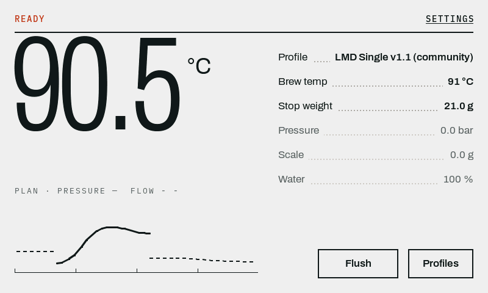
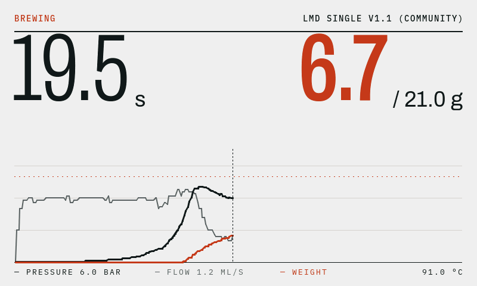
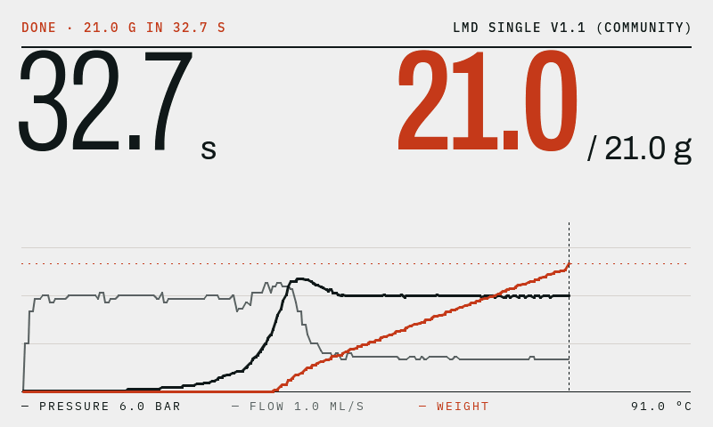
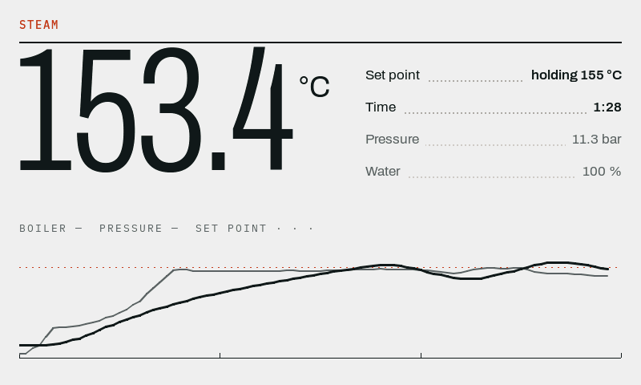
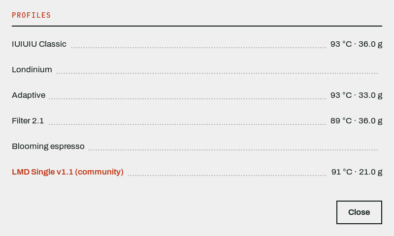
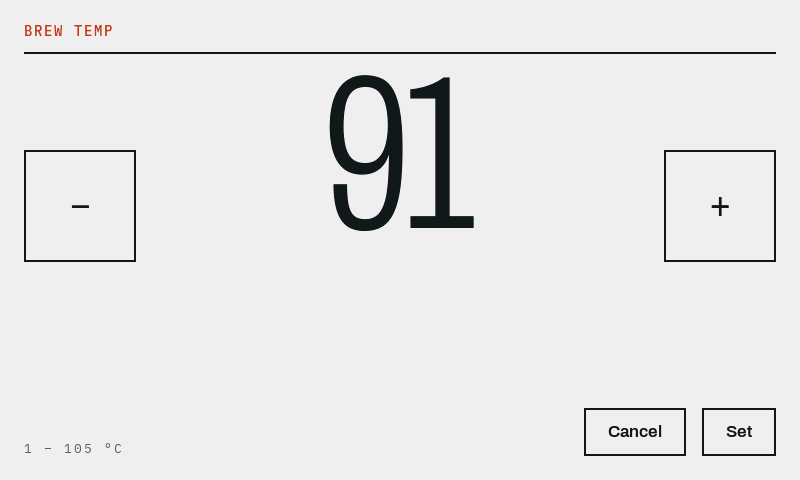
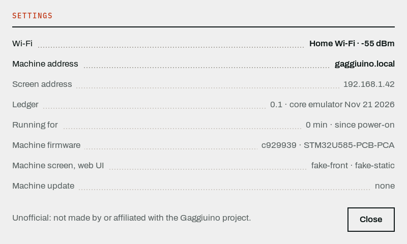
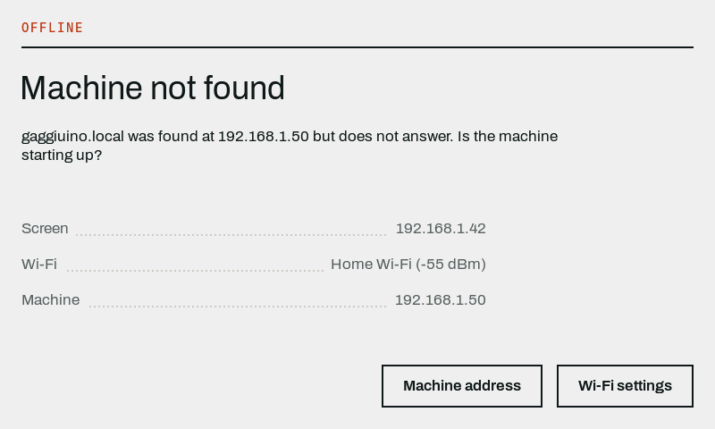
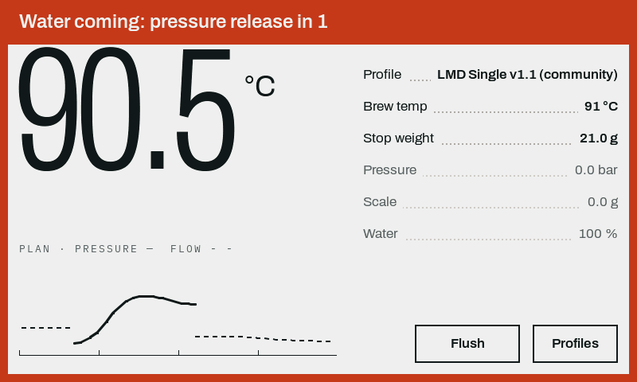
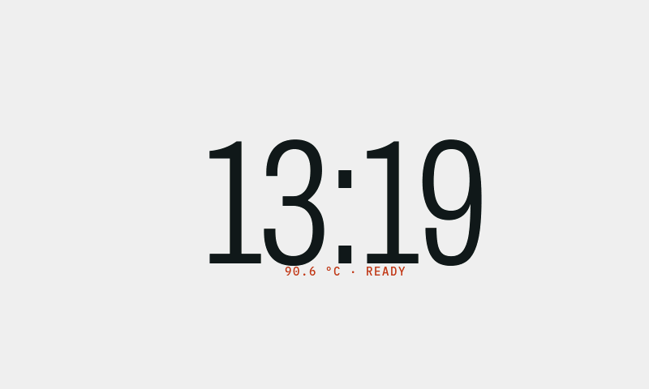

# Ledger

A light, printed-looking touchscreen UI for Gaggiuino machines, running on the
[Brewdeck](https://github.com/pongells/brewdeck) core (LVGL 9, 800 x 480). Paper background, black ink, one red accent:
the number that matters set huge, everything else as a ledger of rows with dotted leaders.

It is also an example of what a UI on the Brewdeck core can look like: Brewdeck's own UI is dark and rounded, Ledger
shares none of its code or look, only the core (Wi-Fi, the machine's API, settings, the commands and their safety
checks). Start your own from the [UI template](https://github.com/pongells/brewdeck-ui-template).

Unofficial: not made by or affiliated with the Gaggiuino project.



## Screens

| | |
|---|---|
|  |  |
| **Brewing:** time and weight (to the stop weight), a chart of pressure (ink), flow (grey) and weight (red) with the stop weight dotted. | **Done:** the result; a tap or 60 s goes back to Ready. |
|  |  |
| **Steam:** boiler temperature, set point, time, pressure, water; a chart of the boiler and the pressure. | **Profiles:** every profile with its brew temperature and stop weight; a tap selects it (and saves it as the machine's boot profile). |
|  |  |
| **Editor:** brew temperature (1-105 °C) or stop weight (0-200 g, 0 = none) with − / +, saved on the machine. | **Settings** (from the Ready header): Wi-Fi, machine address, and what the screen and the machine run. |
|  |  |
| **Offline:** what the screen is doing, then what is wrong and why, with the addresses; Try again, Machine address, Wi-Fi settings. | **Pressure release:** when the machine counts down to releasing pressure (water comes out of the group), a red bar and frame pulsing on each beat, over everything. |
|  | |
| **Standby:** after 10 min without a touch a clock at half brightness; after 30 min the screen goes off. A touch, a shot, steam, a flush or a machine notice wakes it. | |

Also: **Ready** (boiler temperature; profile, brew temperature, stop weight, pressure, scale, water; the active
profile's plan; Flush: tap for flush mode, hold for the timed flush), a **splash** at start, and **Wi-Fi** (the networks
around, join with the on-screen keyboard, Forget; the machine address with the same keyboard). Screenshots from
Brewdeck's emulator (a fake machine with recorded data).

## Build

Like the [template](https://github.com/pongells/brewdeck-ui-template): the first build fetches the Brewdeck release
named in `BREWDECK_REF` into `.brewdeck/` (git-ignored); `BREWDECK=/path/to/brewdeck` uses a checkout of your own.

```sh
./emu.sh                 # the emulator: a fake machine in a window (needs SDL2: brew install sdl2)
./fw.sh ui-p4            # firmware for the Guition JC4880P443 (ESP32-P4)
./fw.sh ui --flash       # firmware for the Sunton ESP32-8048S043 (ESP32-S3), then flash
```

Read Brewdeck's README, "Installing", before flashing: a backup of the board's flash is required, and a Gaggiuino
screen has encrypted flash (`GAGGI_BACKUP=/path/to/backup.bin`, `DRY_RUN=1` shows what it would do). Standby quickly in
the emulator: `LEDGER_DIM_S=8 LEDGER_OFF_S=16 ./emu.sh`.

The whole UI is one file, `ui/ledger.cpp`.

## Fonts

Archivo (condensed for the big numbers) and IBM Plex Mono, both under the SIL Open Font License (`ui/fonts/src`).
`tools/make_fonts.sh` converts them to LVGL fonts in `ui/fonts/` (needs uv and Node). Each font holds only the
characters listed in that script: add a character there before using it in the UI.

## Features

Ledger follows Brewdeck's feature list ([docs/ui-features.md](https://github.com/pongells/brewdeck/blob/main/docs/ui-features.md)).
`ui/ui-features.txt` lists what it leaves out or does only in part (no shot review, history or notices list yet,
no keypad, no display settings). Brewdeck's shared UI scenarios check the rest: `./checks.sh` writes the full table
(`checks/status.md`) and screenshots (`checks/sheet.html`); CI keeps them as the `ui-checks` artifact. They need a
Brewdeck newer than v0.2.0 (`BREWDECK_REF`, or `BREWDECK=/path/to/brewdeck`); with v0.2.0 they are skipped.

Seen on the real screen (ESP32-P4): Ready, the profile pick, a shot, flush. Only in the emulator so far: brew
temperature and stop weight changes on the machine, steam, the pressure release, standby, Settings, Wi-Fi and the
offline page, the time axis growing during a long shot.

## License

MIT (`LICENSE`); the fonts are under the SIL Open Font License (`ui/fonts/src`). The Brewdeck core it is built with is
under the PolyForm Noncommercial License 1.0.0.
